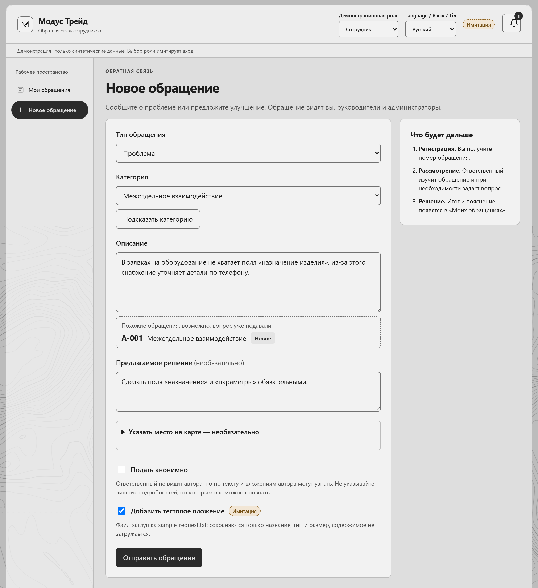
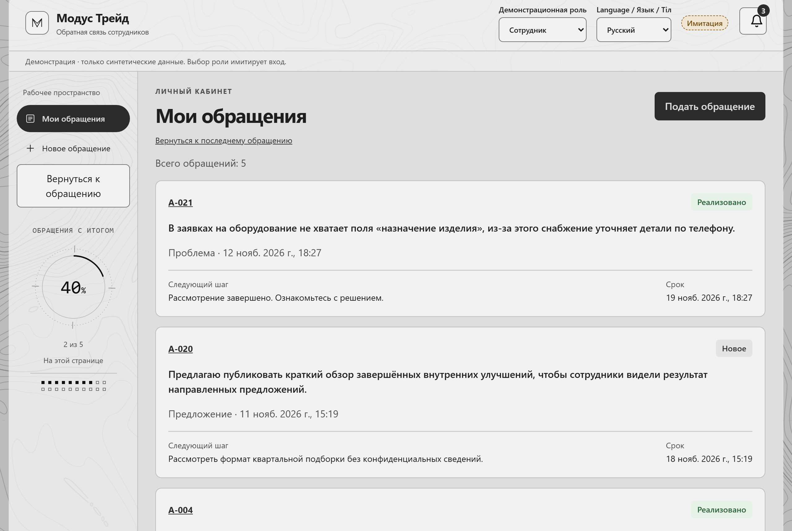
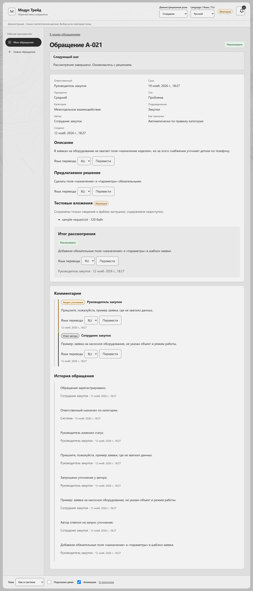
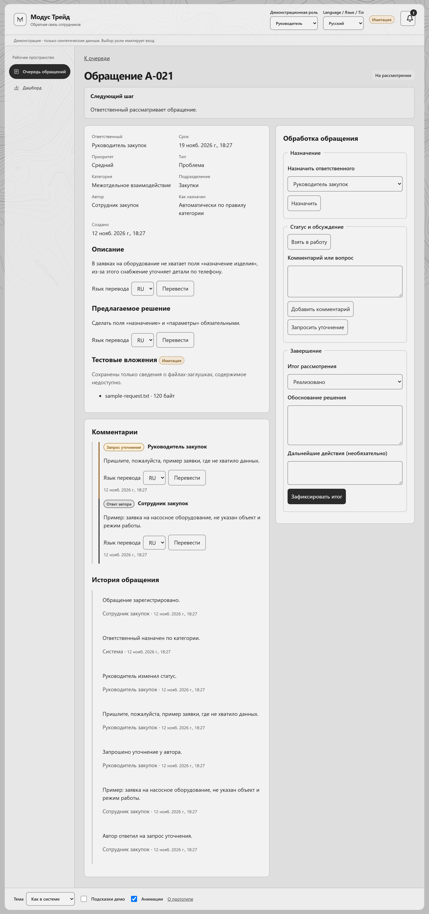
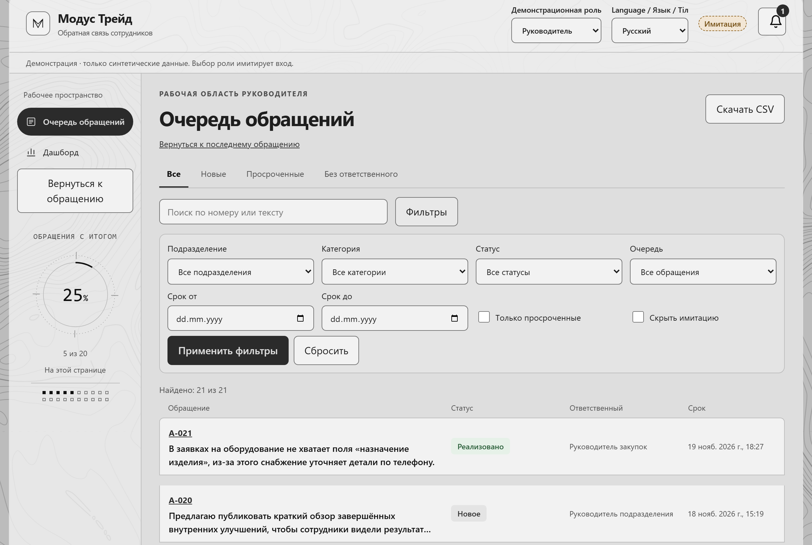
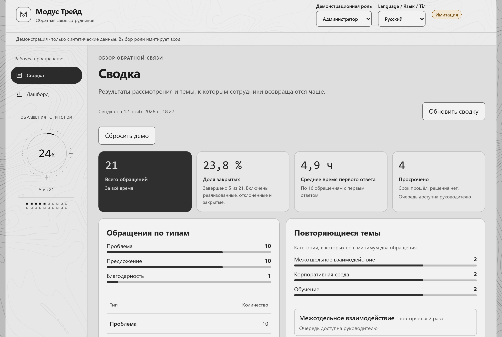
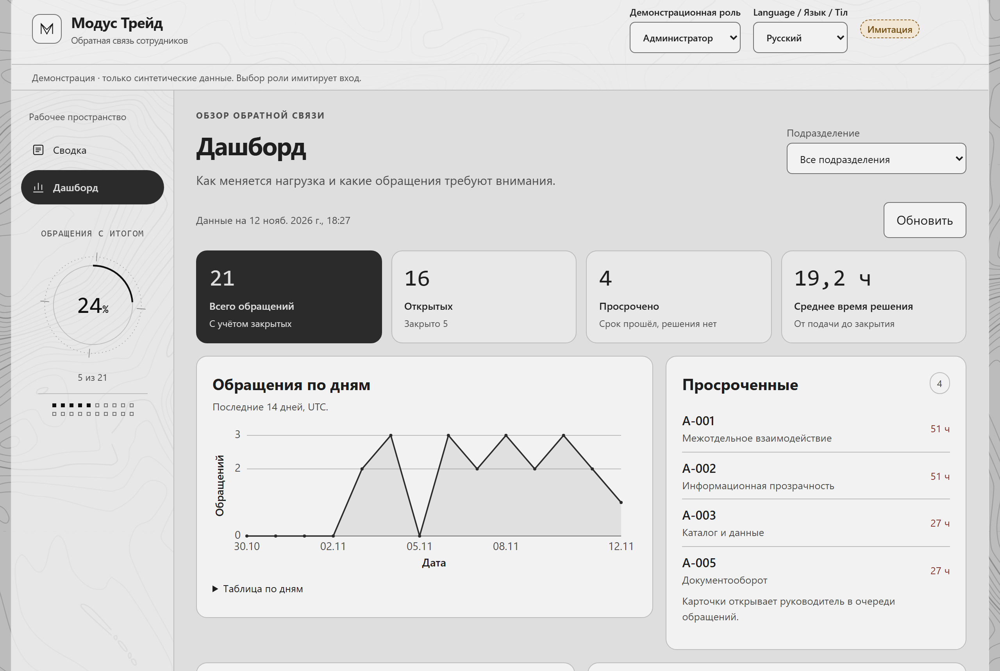

# Обратная связь сотрудников «Модус Трейд»

**[Открыть демо «Модус Трейд»](https://employee-feedback-x627.onrender.com/)**<br>
На экране входа выберите «Сотрудник закупок», «Руководитель» или «Администратор» (быстрый вход без пароля) или нажмите «Войти по учётной записи»: логин `manager-1` (или ФИО), демо-пароль `demo1234`.<br>
После простоя стенд может запускаться около минуты. При необходимости используйте [локальный запуск](#запуск) через `npm run demo` или `docker compose up --build`.

MVP для хакатона по ТЗ группы компаний «Модус Трейд»: веб-система, где сотрудник сообщает о проблеме или предлагает улучшение, а компания отвечает по понятному процессу.

**Проблема.** Сейчас замечания сотрудников теряются в переписке и устных разговорах: непонятно, кто отвечает за вопрос, в каком он состоянии и чем закончился. Руководство не видит, какие темы повторяются.

**Что даёт система.** У каждого обращения есть номер, ответственный, срок и история. Автор видит статус и итог, в том числе мотивированный отказ. Руководитель работает с очередью, а администратор видит сводку: сколько обращений каждого типа, какая доля закрыта, как быстро отвечают и какие темы повторяются.

Все данные в демо синтетические. Реальных данных компании, сотрудников и клиентов в репозитории нет.

**Три роли**

| Роль | Что делает |
|---|---|
| Сотрудник | Подаёт проблему, предложение или благодарность, следит за статусом в «Моих обращениях», отвечает на уточнение, видит итог |
| Руководитель | Работает с очередью: поиск и фильтры, назначение, статусы, вопросы автору, решение или мотивированный отказ; смотрит дашборд |
| Администратор | Смотрит сводку и дашборд по всем обращениям |

**Путь обращения:** сотрудник подаёт обращение и получает номер `A-0XX` → ответственный назначается по категории (или обращение попадает в общую очередь) → руководитель берёт в работу и при необходимости спрашивает автора → фиксирует решение или мотивированный отказ → автор видит итог → администратор видит обращение в сводке.

## Содержание

- [Экраны](#экраны)
- [Запуск](#запуск)
- [Демо-пользователи и сценарий показа](#демо-пользователи-и-сценарий-показа)
- [Что реализовано, что имитация, что в планах](#что-реализовано-что-имитация-что-в-планах)
- [Интеграции с 1С и Битрикс24](#интеграции-с-1с-и-битрикс24)
- [Тесты](#тесты)
- [Стек и устройство](#стек-и-устройство)
- [Документы](#документы)
- [Команда](#команда)

## Экраны

Снимки сделаны с текущей версии на синтетических данных скриптом [infra/screenshots/capture.mjs](infra/screenshots/capture.mjs): он сам проходит демо-путь в браузере. Шапка с плашкой «Имитация» и переключателем роли видна на каждом экране.

**1. Подача обращения (сотрудник).** Тип, категория, описание, предлагаемое решение. Под описанием система подсказывает похожие обращения, кнопка «Подсказать категорию» предлагает категорию по тексту. Есть анонимная подача и необязательная точка на карте. Вложение помечено как имитация.



**2. Мои обращения (сотрудник).** Список своих обращений со статусами. Чужие обращения сотруднику не видны.



**3. Карточка с историей и итогом (сотрудник).** Следующий шаг, ответственный и срок, итог рассмотрения с обоснованием, переписка по уточнению и полная история обращения.



**4. Карточка в работе (руководитель).** Смена статуса, назначение, вопрос автору, фиксация итога. Для отказа поле «Мотивированный отказ» обязательно.



**5. Очередь руководителя.** Вкладки «Новые», «Просроченные», «Без ответственного», поиск по номеру или тексту, фильтры по подразделению, категории, статусу, сроку, выгрузка CSV.



**6. Сводка администратора.** Всего обращений, доля закрытых, среднее время первого ответа, просроченные, разбивка по типам и повторяющиеся темы.



**7. Дашборд.** Нагрузка по дням, просроченные обращения, разбивка по категориям и подразделениям, сводка за неделю.



## Запуск

### Основной способ: одна команда без Docker

Нужны Node.js 22.12 или новее и npm. Нужен доступ к npm-реестру при первой установке пакетов. Docker, база данных и ключ ИИ не нужны.

```sh
npm run demo -- --web-port 5173
```

Команда ставит отсутствующие зависимости из lockfile, собирает API и фронтенд, запускает оба процесса и печатает адреса:

- приложение: `http://127.0.0.1:5173`;
- проверка работоспособности: `http://127.0.0.1:5173/api/health`, отвечает `200` и `{"status":"ok"}`.

Без `--web-port` порты выбираются свободные, адрес выводится в терминале. `--api-port 3000` задаёт порт API, `--no-install` пропускает установку, `--help` выводит справку. `npm run dev` и `npm start` запускают то же самое.

**Остановка:** Ctrl+C в терминале останавливает оба процесса.

**Повторный чистый показ:** `npm run demo:reset -- --web-port 5173` или кнопка «Сбросить демо» на странице сводки администратора.

### Где хранятся данные

| Как запущено | Где данные | Что после перезапуска |
|---|---|---|
| `npm run demo`, `docker compose up` (по умолчанию) | в памяти процесса API | возвращаются исходные 20 синтетических обращений из `api/data/seed.json` |
| задана переменная `PERSIST_FILE=<путь к файлу>` | JSON-файл на диске | данные сохраняются; `npm run demo:reset` запускает исходный набор, файл не трогает |
| задана переменная `DATABASE_URL` (Postgres) | таблица в Postgres (JSONB) | данные сохраняются; так настроен образ для хостинга |

Все переменные окружения описаны в [infra/ENV.md](infra/ENV.md). Ни одна не обязательна для локального показа.

### Вариант с Docker

Нужен Docker с плагином Compose.

```sh
docker compose up --build
```

- Приложение: `http://localhost:8080`, проверка: `http://localhost:8080/api/health`.
- Другой порт: `WEB_PORT=9000 docker compose up --build` (PowerShell: `$env:WEB_PORT=9000; docker compose up --build`).
- Остановка: Ctrl+C, затем `docker compose down`.

## Демо-пользователи и сценарий показа

На экране входа выберите демо-учётку. Во время показа роль можно сменить переключателем «Демонстрационная роль» в шапке. Фронтенд передаёт заголовок `X-Demo-User`, сервер проверяет права на каждый запрос.

**Вход по логину и паролю.** Рядом с быстрым выбором роли есть кнопка «Войти по учётной записи». Логин: код (`employee-1`, `manager-1`, `admin-1`) или ФИО; у встроенных демо-учёток пароль `demo1234`. Пароли хранятся хэшем (scrypt) в базе, токен входа подписан и действует 12 часов (`SESSION_SECRET` в окружении задаёт ключ подписи, без него ключ случайный и перезапуск разлогинивает всех). Администратор задаёт пароль при создании человека в разделе «Пользователи и права». Там же: «Структура» (подразделения и люди в них) и «Журнал действий» (вход, выход, неудачные попытки, создание обращений, назначения, статусы, ответы, решения, правки людей и правил). Журнал, люди и пароли хранятся в Postgres и переживают перезапуск; при запуске без базы журнал живёт в памяти процесса.

| Роль в переключателе | Пользователь | Что показать |
|---|---|---|
| Сотрудник | `employee-1`, сотрудник закупок | подача, «Мои обращения», ответ на уточнение, итог |
| Руководитель | `manager-1`, руководитель закупок | очередь, фильтры, просроченные, назначение, статусы, уточнение, решение и отказ, CSV, отмена действия |
| Администратор | `admin-1` | сводка, дашборд, сброс демо |

На экране входа также доступен «Сотрудник бухгалтерии» (`employee-2`). Он видит только свои обращения. Запрос чужой карточки через API возвращает 404.

Сценарий на 3–5 минут:

1. Сотрудник подаёт обращение и получает номер.
2. Обращение само назначено руководителю по категории. Категория «без ответственного (демо)» попадает в общую очередь.
3. Руководитель берёт обращение в работу и запрашивает уточнение. Сотрудник отвечает в карточке.
4. Руководитель фиксирует решение или мотивированный отказ (без объяснения сохранить нельзя). Сотрудник видит итог.
5. Руководитель ищет и фильтрует очередь, находит просроченные.
6. Администратор открывает сводку и дашборд.

Подробный сценарий и что говорить честно: [infra/DEMO.md](infra/DEMO.md).

## Что реализовано, что имитация, что в планах

### Реализовано

- Подача обращения: тип (проблема, предложение, благодарность), категория, описание, предлагаемое решение, регистрационный номер. Проверка полей с понятными ошибками.
- Анонимная подача: ответственный не видит автора, автор видит своё обращение в «Моих обращениях».
- Необязательная точка на карте (Leaflet). Координаты можно ввести вручную, тайлам OpenStreetMap нужна сеть.
- Подсказка похожих обращений при вводе описания и подсказка категории по тексту.
- Назначение ответственного по правилу категории, общая очередь для обращений без ответственного, ручное назначение.
- Статусы только по допустимым переходам, сроки и признак просрочки, история, комментарии, запрос уточнения и ответ автора.
- Решение и мотивированный отказ, итог виден автору.
- Права проверяются на сервере: сотрудник видит только свои обращения, очередь доступна руководителю, сводка администратору, дашборд руководителю и администратору.
- Очередь: вкладки, поиск по номеру и тексту, фильтры (подразделение, категория, статус, тип, срок, просрочка), пагинация, фильтры сохраняются в адресе страницы, выгрузка CSV.
- Отмена последнего действия руководителя (статус или назначение) в течение 10 минут.
- Сводка и дашборд: количество по типам, доля закрытых, среднее время первого ответа и решения, повторяющиеся темы, разбивка по подразделениям и категориям, график по дням.
- Интерфейс на русском, английском и казахском, светлая и тёмная тема. Выбор сохраняется после перезагрузки.
- Ограничение частоты записи на пользователя, сброс демо-данных.
- Запуск одной командой (`npm run demo`) и через Docker Compose, сквозной тест демо-пути на Playwright.

### Демо-имитации

Эти части работают в демо, но не являются промышленной реализацией. В интерфейсе они помечены плашкой «Имитация».

- **Вход.** Роль выбирается переключателем в шапке, пароля нет. Это не защищённая аутентификация: любой, кто имеет доступ к сайту, может выбрать любую роль.
- **Вложения.** Флажок «Добавить тестовое вложение» прикрепляет файл-заглушку `sample-request.txt`. Сохраняются только имя, тип и размер, содержимое не загружается.
- **Хранение.** По умолчанию данные живут в памяти процесса API и сбрасываются при перезапуске. Постоянное хранение включается переменными `PERSIST_FILE` (файл) или `DATABASE_URL` (Postgres, обращения хранятся как JSONB без нормализованной схемы).
- **ИИ.** Без ключа сеть не используется: подсказка категории берётся из записанных примеров и словарных правил, сводка за неделю строится по шаблону и помечена «Шаблон (без ИИ)». Если на сервере заданы ключи (`GEMINI_API_KEY`, затем `XAI_API_KEY` или `GROQ_API_KEY`, затем `ANTHROPIC_API_KEY`), подсказки, сводку за неделю и кнопку «✦ Помощь ИИ» на карточке обращения (2–3 варианта решения с плюсами и минусами) ведёт модель по цепочке; при таймауте или отсутствии ключей включаются правила без ИИ, анонимные обращения в модель не уходят. По кнопке «Перевести» доступен перевод сообщений. Без ключа перевод честно сообщает о недоступности, оригинал остаётся на месте. Ключ хранится только в окружении сервера и в сборку фронтенда не попадает.
- **Уведомления.** Колокольчик в шапке показывает события внутри приложения: запрошено уточнение, принято решение, обращение без ответственного, ответ автора, срок скоро истекает. События вычисляются из истории обращений и помечены «Имитация: в промышленной версии email / Битрикс24». Письма и сообщения в Битрикс24 не отправляются.
- **Живой поток обращений.** Отдельная команда `npm run demo:sim` по желанию создаёт обращения и действия от имени демо-пользователей. Такие обращения помечены как имитация, их можно скрыть фильтром. Включается только явно, см. [docs/demo-simulation.md](docs/demo-simulation.md).

### Планы

- Настоящая аутентификация (например, вход через корпоративный Битрикс24) и права по оргструктуре.
- Нормализованная схема в PostgreSQL и объектное хранилище для настоящих файлов.
- Уведомления по почте и в Битрикс24.
- Обмен с Битрикс24 и 1С, см. следующий раздел.
- Опросы, NPS и обратная связь от клиентов.

## Интеграции с 1С и Битрикс24

По уточнению организатора интеграции с 1С и Битрикс24 для хакатона не обязательны. В компании используется облачный Битрикс24.

В текущей версии реальных интеграций нет: система не обменивается данными ни с Битрикс24, ни с 1С, ключей и адресов этих систем в проекте нет.

Возможный обмен — только план. Например: вход сотрудников через Битрикс24, уведомления ответственным в Битрикс24, передача принятых предложений задачами. Условия такого обмена неизвестны: какие права дадут стороннему приложению в облачном Битрикс24, какие данные можно передавать, нужна ли 1С и в каком объёме. Их нужно согласовать с компанией. Разбор вариантов: [docs/research/integrations.md](docs/research/integrations.md).

## Тесты

Из корня репозитория (перед первым запуском `npm --prefix api ci` и `npm --prefix web ci`):

```sh
npm --prefix api test                          # сборка, контрактные и юнит-тесты API
npm --prefix web test                          # типы из контракта и тесты Vitest
npm --prefix web run lint
node --test "tests/acceptance/**/*.test.*js"   # приёмочные тесты по критериям задач
```

Сквозной тест демо-пути в браузере:

```sh
npm --prefix tests/e2e ci
npm --prefix tests/e2e run e2e:install         # один раз: браузер Chromium
npm run test:e2e                               # сам поднимает API на 3000 и фронтенд на 5173
```

Против уже запущенного стенда: задать `E2E_BASE_URL` (например, `http://127.0.0.1:5173`) и выполнить `npm run test:e2e`.

## Стек и устройство

```
Браузер ──► фронтенд React (Vite) ──► /api/* ──► Fastify API (Node 22) ──► память, файл или Postgres
```

| Часть | Технологии | Папка |
|---|---|---|
| Фронтенд | React 19, TypeScript, Vite, React Router, openapi-fetch, Leaflet, Vitest | `web/` |
| API | Fastify 5, TypeScript, проверка запросов по контракту (Ajv) | `api/` |
| Контракт | OpenAPI, единый источник правды для API, типы фронтенда генерируются из него | `contracts/api.yaml` |
| Запуск | `infra/run-demo.mjs`, Docker Compose с nginx | `infra/`, `docker-compose.yml` |
| Тесты | приёмочные (Node test runner), юнит, E2E на Playwright | `tests/`, `api/test/`, `web/tests/` |

## Документы

- [docs/tz.md](docs/tz.md): ТЗ организаторов; [docs/tz-analysis.md](docs/tz-analysis.md): разбор ТЗ и сценарий демо.
- [docs/architecture.md](docs/architecture.md), [design/diagrams/](design/diagrams/): архитектура и схемы.
- [docs/dataset.md](docs/dataset.md): синтетические данные.
- [infra/DEMO.md](infra/DEMO.md): сценарий показа; [infra/README.md](infra/README.md): запуск, Docker, хостинг, архив для сдачи; [infra/ENV.md](infra/ENV.md): переменные окружения.
- [contracts/api.yaml](contracts/api.yaml), [api/README.md](api/README.md), [web/README.md](web/README.md): API и фронтенд.
- [infra/readme-validation.md](infra/readme-validation.md): как проверялся этот README.

## Команда

| Участник (GitHub) | Роль |
|---|---|
| GredesCerber | Капитан, бэкенд |
| punyzxc | Фронтенд |
| Ami-m1nzyi | Дизайн, сценарии, тесты и инфраструктура |
| Wohorchik | Исследования и полировка |

Работа велась людьми вместе с ИИ-агентами.
