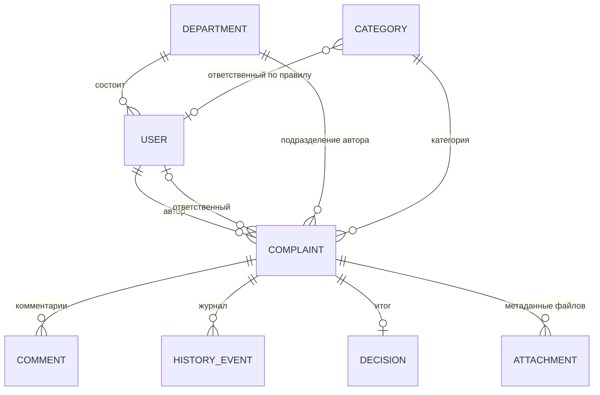
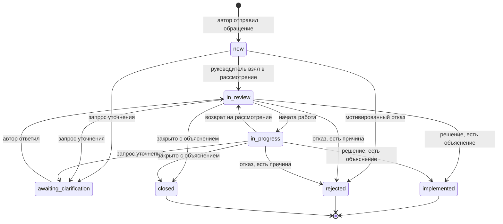

# Модель данных и жизненный цикл обращения

Опора: [ТЗ п. 2.3–2.5](../../docs/tz.md), [датасет](../../docs/dataset.md), требования R2, R3, R4 ([разбор ТЗ](../../docs/tz-analysis.md)). Модель совпадает с принятым [контрактом API](../../contracts/api.yaml); при расхождении источником правды остаётся контракт. Права по ролям описаны в [access.md](access.md).

## 1. Сущности

### Пользователь (User)
| Поле | Тип | Смысл |
|---|---|---|
| `id` | строка | Демо-идентификатор: `employee-1`, `manager-1`, `admin-1` |
| `name` | строка | Условное отображаемое имя (синтетическое) |
| `role` | `employee` / `manager` / `admin` | Роль, определяется сервером |
| `departmentId` | строка | Подразделение |

### Подразделение (Department) и категория (Category)
| Поле | Тип | Смысл |
|---|---|---|
| Department: `id`, `name` | строки | Справочник подразделений |
| Category: `id`, `name` | строки | Справочник категорий |
| Category: `assigneeId` | строка или `null` | Руководитель по правилу маршрутизации; `null` значит «правила нет», обращение пойдёт в очередь без ответственного (R2) |
| Category: `dueInDays` | целое | Срок рассмотрения в календарных днях от создания |

### Обращение (Complaint)
| Поле | Тип | Смысл |
|---|---|---|
| `id`, `number` | строки | Внутренний идентификатор и видимый номер вида `A-021` (уникален, растёт) |
| `type` | `problem` / `suggestion` / `praise` | Проблема, предложение, положительный отзыв |
| `categoryId`, `departmentId` | строки | Категория и подразделение автора (берётся с сервера) |
| `author` | User | Автор, определяется сервером, не телом запроса |
| `description` | строка | Текст обращения (обязателен, не пустой) |
| `proposedSolution` | строка или `null` | Предлагаемое решение, необязательно |
| `priority` | `low` / `medium` / `high` | Приоритет, по умолчанию `medium` |
| `attachments` | массив Attachment | Только метаданные файлов-заглушек |
| `status` | один из 7 статусов | Текущий статус (раздел 2) |
| `assignee` | User или `null` | Ответственный |
| `routing` | `{queue, reason}` | `assigned` / `unassigned` и причина: `category_rule`, `no_rule`, `manual_assignment` |
| `createdAt`, `updatedAt`, `dueAt` | дата-время UTC | Создание, последнее изменение, срок (`createdAt + dueInDays`) |
| `firstResponseAt` | дата-время или `null` | Первое действие руководителя; ставится один раз, основа метрики R7 |
| `closedAt` | дата-время или `null` | Время итогового решения |
| `overdue` | логическое | Вычисляется при чтении: не завершено и `dueAt` в прошлом; отдельным статусом не хранится |
| `comments`, `history` | массивы | Комментарии и журнал (ниже) |
| `decision` | Decision или `null` | Итог рассмотрения |
| `nextAction` | строка | Следующий шаг для автора простым языком |

### Комментарий (Comment)
`id`, `author` (User), `kind` (`comment` обычный, `clarification_request` запрос уточнения от руководителя, `clarification_response` ответ автора), `text`, `createdAt`. Порядок по времени сохраняется.

### Решение (Decision)
`outcome` (`implemented` реализовано, `rejected` отклонено, `closed` закрыто), `explanation` (обязательное непустое объяснение результата или причины отказа, R4), `actions` (что сделано или будет сделано, необязательно), `author` (руководитель), `createdAt`.

### Событие журнала (HistoryEvent)
`id`, `kind` (`created`, `assigned`, `status_changed`, `commented`, `decided`), `actor` (User или `null` для автоматических действий, например назначения по правилу), `createdAt`, `fromStatus`, `toStatus`, `text`. Журнал только дополняется; каждое действие добавляет событие в той же операции, что и изменение данных.

### Вложение (Attachment)
`name`, `mediaType`, `sizeBytes`, `isPlaceholder` (всегда `true` в MVP: файлы не загружаются).

## 2. Жизненный цикл

Статусы из датасета: Новое, На рассмотрении, В работе, Ожидает уточнения, Реализовано, Отклонено, Закрыто.

### Условия переходов
| Переход | Кто | Условие |
|---|---|---|
| создание → `new` | сотрудник | Заполнены тип, категория, описание. Если у категории есть ответственный, он назначается; иначе `routing = unassigned` и обращение видно всем руководителям (R2) |
| `new`/`in_review`/`in_progress` → `awaiting_clarification` | руководитель | Через комментарий `clarification_request`; статус меняется вместе с комментарием |
| `awaiting_clarification` → `in_review` | автор | Через комментарий `clarification_response`; других выходов из ожидания нет |
| `new` → `in_review`, `in_review` ⇄ `in_progress` | руководитель | Прямая смена статуса |
| → `implemented` / `rejected` / `closed` | руководитель | Только через запись решения с непустым `explanation` (R4). `implemented` и `closed` доступны с `in_review` и `in_progress`; `rejected` ещё и из `new` |
| из `implemented`, `rejected`, `closed` | никто | Конечные статусы: любое изменение, включая комментарии и назначение, возвращает 409 |

Положительный отзыв (`praise`) проходит тот же цикл; на практике его закрывают решением `closed` с короткой благодарностью.

Недопустимый переход возвращает 409 с причиной, данные и журнал не меняются. Источником таблицы переходов служит `x-status-transitions` в контракте.

### Что фиксируется на каждом шаге
- `updatedAt` и `nextAction` обновляются при любом изменении.
- `firstResponseAt` ставится первым действием руководителя (смена статуса, назначение, комментарий, решение) и больше не меняется; действия автора его не затрагивают.
- `closedAt` равен времени решения; после этого `overdue` всегда `false`.

## 3. Ограничения и допущения MVP
- Хранилище в памяти, при перезапуске загружается синтетический набор; в развитие SQLite или PostgreSQL (выбор стека за задачей T32).
- Нет реального разделения подразделений, анонимности, уведомлений и интеграций: это план или имитация (см. [access.md](access.md), [интеграции](../../docs/research/integrations.md)).
- Сроки считаются в календарных днях по категории, а не по приоритету; зависимость срока от приоритета остаётся идеей развития.
- Статусы и категории взяты из датасета и условны: реальные списки определит компания.
