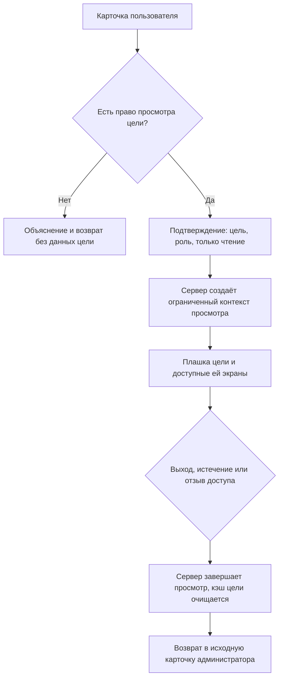

# Сценарии администратора и состояния экранов

Связанные материалы: [навигация](navigation.md), [макет](mockup.html),
[план реализации](implementation-plan.md). Всё ниже относится к будущему
продукту. Макет воспроизводит только локальные визуальные состояния.

## Учётная запись

1. "Пользователи": поиск по имени/логину, фильтры роли и состояния. Выбранные
   фильтры сохраняются при открытии карточки и возвращении. Имя не идентификатор:
   однофамильцы различаются логином и стабильным ID.
2. "Добавить пользователя": имя, логин, роль и согласованная политика первичного
   доступа. До ответа сервера строка не считается созданной. Повторная отправка
   блокируется; после успеха показаны имя, роль и следующий шаг.
3. "Открыть карточку": реквизиты, состояние, роль, кнопки по отдельным правам.
   Пароля, хэша и секретов нет. Изменение логина проверяет уникальность.
4. "Сохранить": сервер проверяет права и версию записи. Конфликт параллельного
   изменения предлагает перечитать карточку, не затирает чужие правки молча.
   Изменения роли показывают подтверждение с итоговым доступом.
5. "Отключить": подтверждение с указанием пользователя и последствиями для
   активных сессий. Предлагаем немедленно закрывать доступ; согласовать в контракте.
   Последнего активного администратора отключить или лишить прав нельзя.
   Включение не восстанавливает отозванные секреты автоматически.
6. "Сбросить пароль": явное подтверждение. Старый пароль не виден никому.
   Сервер создаёт согласованный одноразовый доступ, ограничивает срок, фиксирует
   действие без секрета. UI показывает результат и способ доставки.
   Если выбран временный пароль, показать его можно только однократно в защищённом
   подтверждении и потребовать замену при первом входе. Никаких постоянных паролей
   в карточке, журнале, экспорте и скриншотах.

Первого администратора создаёт отдельно документированный bootstrap, не
анонимная публичная регистрация. Кто и как запускает bootstrap, выбирается
при проектировании входа #288; секреты не должны быть зашиты в приложение.

## Роль и матрица

Создать роль с новым stable ID → задать название/описание → выбрать поддерживаемые
возможности → сохранить. Переименовать существующую роль можно без потери
назначений; имя не участвует в проверках прав. Копия получает отдельный ID.
Назначенную роль нельзя удалить: сначала переназначить пользователей и подтвердить
последствия. Встроенная роль не удаляется, но её отображаемое название изменяемо.
Архивная пользовательская роль недоступна для нового назначения; восстановление
проверяет те же ограничения.

Выбрать роль → увидеть описание, пользователей и текущую матрицу → изменить
разрешённые возможности → увидеть различия и число затронутых пользователей →
подтвердить → получить серверную версию и сообщение об успехе.

Перед каждым изменением показать прежнее и новое название/права, число назначенных
учёток и результат подтверждения. Защита последнего администратора проверяет
системный ID/серверные полномочия, а не текущий текст названия роли.
Нельзя отправлять неизвестное право или редактировать встроенную защиту
последнего администратора. Отказ на API не заменяется локальным успешным
состоянием. Отзыв прав проверяется на следующем запросе; кэш UI обновляется.
Способ инвалидирования действующих сессий и токенов должен быть определён
в контракте, а не зависеть от скрытой кнопки.

## "Глазами пользователя"

### Вход и выход

В карточке неактивной учётки кнопка недоступна с пояснением. Нельзя запускать
вложенный просмотр из просмотра. Пока действует контекст цели, административное
меню и ранее загруженные административные данные не показываются.

Плашка на каждом экране: "Просмотр как <имя>, <логин>, <роль>. Только чтение".
Рядом доступна кнопка "Вернуться к администратору", в том числе при ошибке,
отказе доступа и на телефоне. Фокус переводится на плашку при входе и на
исходную карточку после выхода. Ограничение не передаётся только цветом.

### Серверные границы

Это **не** подстановка `X-Demo-User` из браузера и не вход с паролем цели.
Нужен отдельный согласованный серверный механизм с проверкой исходной сессии,
права preview и разрешённой цели. Как именно передаётся контекст, срок его жизни,
защита от CSRF и формат ошибок определяются задачей contracts/API.

- В каждом запросе различаются реальный actor и effective user (цель).
- Чтение разрешено только в области цели и в согласованном списке безопасных
  операций просмотра. Не используется объединение её прав с правами администратора.
- Нельзя читать чужие обращения или автора анонимного обращения, если цель
  этого не видит. Маскирование выполняется на сервере, не только в HTML.
- Отправка, изменение роли, пароля, статуса, комментария, решения, сброс демо,
  экспорт и прочие действия с последствиями в первой версии запрещены.
  Кнопки показывают причину, а прямой запрос должен быть отклонён сервером.
- Начало/завершение просмотра являются управляющими операциями исходного actor,
  а не действиями цели. Они должны оставаться доступны для безопасного выхода.
- Отключение цели/администратора, отзыв права или истечение контекста прекращают
  просмотр. После этого данные и кэш цели очищаются; потерянная исходная сессия
  ведёт на вход, а не на незащищённый административный экран.
- Не выдаём исходную административную сессию или секреты цели в URL/localStorage
  макета как пример промышленной реализации. Макет работает только в памяти.

В журнале нужны начало, отказ старта, завершение и причина завершения; реальный
actor ID, target ID, время, результат и correlation ID. Пароли и одноразовые
токены никогда не записываются. Действия нельзя приписывать просматриваемому
сотруднику так, будто он сам вошёл и совершил их.

## Состояния и следующий безопасный шаг

| Состояние | Триггер | Видимое поведение | Следующий шаг |
|---|---|---|---|
| Загрузка | Список/карточка/матрица ещё загружаются | Стабильный каркас, подписанный индикатор, опасные действия недоступны | Дождаться; навигация и выход из просмотра доступны |
| Пусто | Нет учёток или совпадений фильтра | Различаются "нет пользователей" и "ничего не найдено" | Создать при наличии права либо сбросить фильтры |
| Ошибка | Сеть/сервер/конфликт | Понятное сообщение, сохранённый несекретный ввод, без ложного успеха | Повторить; при конфликте перечитать и сверить изменения |
| Частично | Пользователи загрузились, роли/агрегат недоступны | Доступная часть остаётся, недостающая явно отмечена | Повторить проблемную загрузку; не разрешать неподтверждённое изменение роли |
| Нет доступа | Прямой URL или отзыв capability | Старые данные скрыты; объяснение без утечки | Вернуться к доступному разделу; выход из preview остаётся доступен |
| Успех | Сервер подтвердил изменение | Сообщение что изменено и у кого; обновлённая строка | Открыть карточку или продолжить список |
| Отключённая учётка | Статус disabled | Текстовый статус, вход/preview запрещены | Включить при наличии права и после подтверждения |
| Последний администратор | Потеря последнего активного административного доступа | Операция заблокирована с причиной | Назначить другого активного администратора разрешённым способом |

Демонстрационный селектор состояний в макете нужен только для проверки этих
экранов. Он не заменяет реальные ошибки и серверные проверки будущего продукта.

## Управление с клавиатуры и мобильный экран

Tab проходит от шапки к навигации и основному действию, затем к поиску и строкам.
Текущий раздел отмечен `aria-current`. Меню и модальные карточки имеют имя;
Escape закрывает только верхний слой, фокус возвращается на открывшую кнопку.
Модальная карточка удерживает фокус, закрытие с изменёнными реквизитами требует
подтверждения либо сохранённого черновика в будущей реализации.

На 360 px кнопка меню показывает `aria-expanded`; закрытая панель не остаётся
в Tab-порядке. Вход и выход из preview видны без горизонтальной прокрутки.
Предпочтение reduced motion отключает декоративные переходы. Контраст,
переносы длинных имён и результат состояний проверяются на обоих целевых размерах.

## Синтетические демо-учётки

После реализации настоящего входа нужен `infra/DEMO-ACCOUNTS.md`:
сотрудник, второй сотрудник для изоляции, руководитель и администратор,
их синтетические логины, рабочие демо-пароли, роль и сценарий показа.
Данные документа должны совпадать с seed и проверяться входом.
В штатном режиме опубликованный демо-набор не создаётся автоматически.
Этот макет не создаёт таких учёток и не содержит рабочих паролей.
