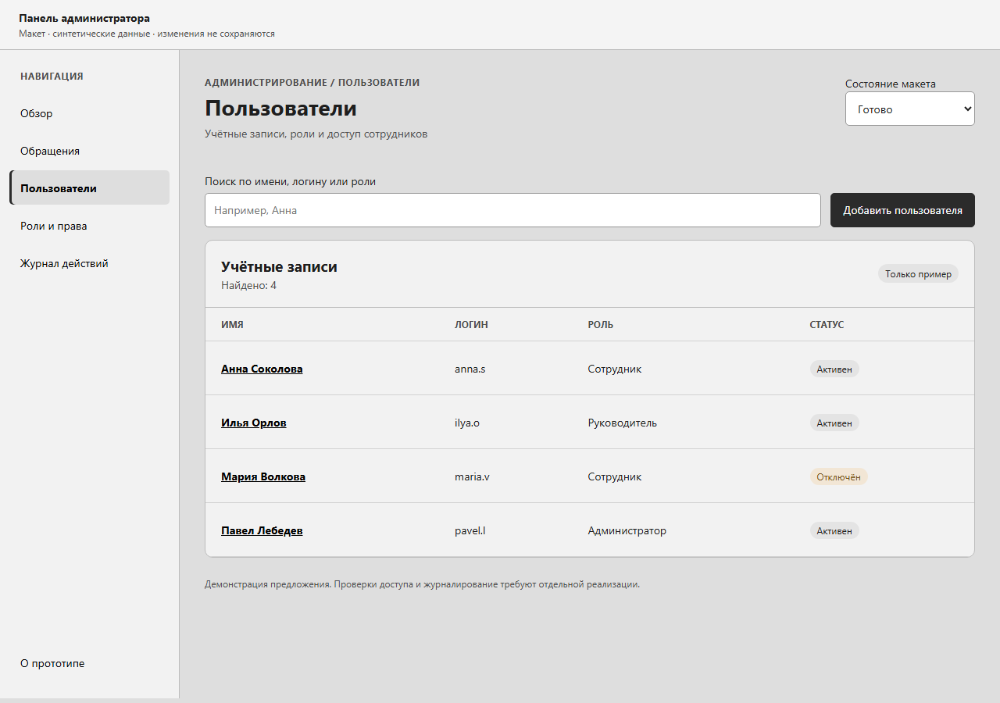
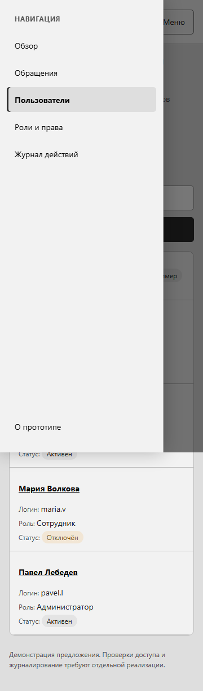
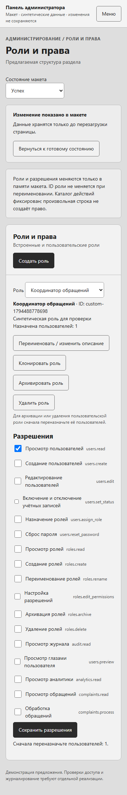
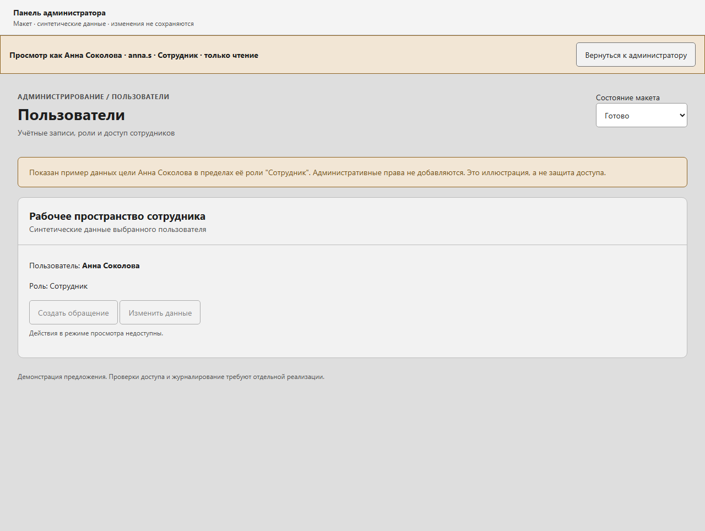

# Проверка спецификации и макета #305

Дата: 12 ноября 2026. Базовый код: `dba0fab62fd84783aa39db429a0078671f91ec1e`.
Объект проверки: автономный [mockup.html](mockup.html), не действующая админ-панель.
Проверялись Chromium/Playwright, локальный HTTP, axe-core 4.14.0,
`prefers-reduced-motion: reduce`. Внешние API и реальные учётки не использовались.

## Результат

29 поведенческих проверок пройдено, 0 ошибок. [Исходные результаты](evidence/checks.json).
Размеры 360x800 и 1280x900. Проверки не доказывают защиту настоящего API и не
означают, что предложенные возможности уже реализованы в продукте.

| Что проверено | Результат |
|---|---|
| Стартовый экран пользователей, активный пункт и закрытое мобильное меню | Пройдено на 360/1280 |
| Мобильное открытие с фокусом, Escape и возврат к кнопке | Пройдено на 360 |
| Видимый фокус клавиатуры | Пройдено на 360/1280 |
| Загрузка, пусто, ошибка, частично, нет доступа, успех и следующий шаг | Пройдено на 360/1280; старые данные скрываются при отказе |
| Карточка и просмотр цели: имя/логин/роль, только чтение, скрытое админ-меню, возврат | Пройдено на 360/1280 |
| Пространство preview после скрытия меню занимает доступную ширину | Пройдено; найденное в первой визуальной проверке сжатие исправлено |
| Последний администратор не отключается | Пройдено в локальной модели, серверная защита не проверялась |
| Длинное имя из 81 символа без пробелов | Переносится без горизонтального скролла документа на 360/1280 |
| Создание роли, переименование с сохранением ID и копирование в новый ID | Пройдено на 360/1280 |
| Изменение матрицы с подтверждением и числом затронутых учёток | Пройдено на 360/1280 |
| Архивирование, восстановление и удаление неназначенной пользовательской роли | Пройдено на 360/1280, удаление требует подтверждения |
| Назначение созданной роли и отказ её удаления при существующем назначении | Пройдено на 360/1280 |
| Переименование системного администратора не обходит защиту по ID | Пройдено на 360/1280 |
| Переключение видов сводки/динамики | Пройдено; обычные кнопки с aria-pressed, не ARIA-tab интерфейс |
| Axe WCAG 2 A/AA, 2.1 A/AA, 2.2 AA на стартовом списке | 0 violations и 0 incomplete на двух размерах |
| Runtime-ошибки и внешние запросы макета | 0/0 на двух размерах |

Проверены базовые элементы клавиатурного пути и выборка axe, не полная
совместимость со скринридерами. Firefox, Safari, все возможные сочетания прав
и серверная безопасность вне этой проверки. Для продукта потребуются
контрактные, негативные, интеграционные и E2E-тесты из [плана](implementation-plan.md).

Ручной просмотр изображений подтвердил переносы, визуальную иерархию и
наличие плашки preview. Это просмотр макета исполнителем, не исследование с
сотрудниками компании. Согласованного визуального baseline нет, поэтому
сравнение с baseline не выполнялось и не объявляется пройденной регрессией.

## Полнота перечня и границы воспроизведения

Главный перечень: [admin-capabilities.md](admin-capabilities.md).
В макете воспроизводится ключевой цикл ролей и пользователей; карточки и
операции меняют только память страницы. Имя/логин редактируются, дубликат
логина отклоняется локальным примером; постоянного хранилища нет.

Журнал и административный список обращений пока представлены как планируемые
экраны. Фактические сессии, bootstrap, доставка сброса, сохранение журнала,
отзыв серверных прав, гонки last-admin и файл с рабочими паролями не реализованы
в макете. Сообщение о сбросе лишь иллюстрирует будущий одноразовый доступ.
Демо-учётки и `infra/DEMO-ACCOUNTS.md` должны появиться вместе с реальным входом.

## Воспроизвести проверку

Из корня этого репозитория, при Node/npm и Python:

```powershell
npm ci --prefix tests/e2e
npm --prefix tests/e2e run e2e:install
npm install --prefix .hk/qa-tools --no-save --package-lock=false axe-core@4.14.0
# В другом терминале:
python -m http.server 5195 --bind 127.0.0.1 --directory design/admin
# Затем:
node design/admin/validate.mjs
```

`ADMIN_MOCKUP_URL` задаёт другой локальный адрес макета. Скрипт взаимодействует
только с автономным макетом, создаёт синтетические объекты в памяти страницы,
принимает его подтверждения и пересоздаёт `evidence/checks.json` и снимки.
Не запускайте его против реальной админ-панели: это проверка конкретного макета.
Перезагрузка страницы восстанавливает исходные синтетические данные.

Полный `hk check` выполнен до сдачи, все шесть шагов зелёные; повторный прогон
на коммите сдачи фиксируется в PR. Этот прогон проверяет регрессии проекта,
а не реализацию планируемой админ-панели. Изменяемые файлы только `design/admin/**`.

## Примеры экранов





