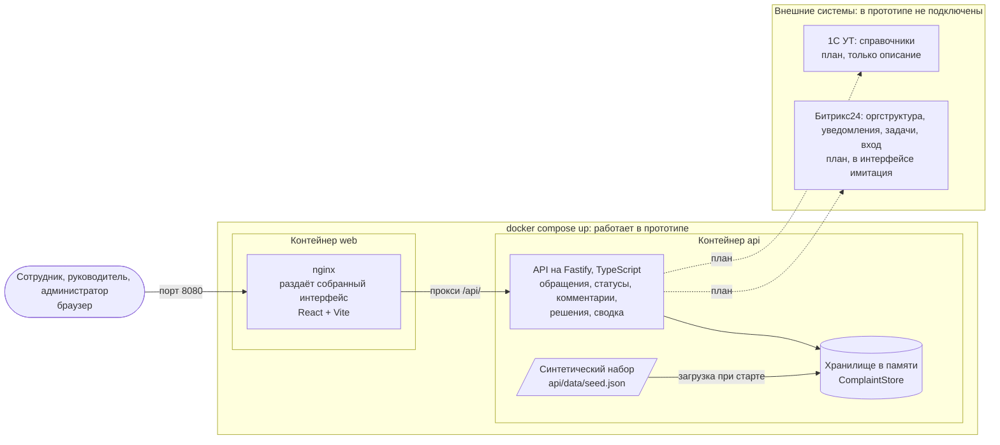

# Архитектура решения

> Задача #108. Сверено с `docker-compose.yml`, `infra/nginx.conf`, `infra/web.Dockerfile`, `infra/api.Dockerfile` и `api/src` (`app.ts`, `complaints.ts`, `lifecycle.ts`, `analytics.ts`, `store.ts`, `seed.ts`).

**Подпись:** Архитектура прототипа: веб-интерфейс, API и хранилище в памяти; 1С и Битрикс24 показаны как план.

**Что сказать на слайде:** Прототип поднимается одной командой и состоит из двух контейнеров: nginx отдаёт интерфейс и проксирует запросы в API, а API хранит синтетические обращения в памяти. Интеграции с 1С и Битрикс24 мы честно показываем как план: в прототипе подключений нет, обмен только описан.

## Что есть что

| Блок на схеме | Где в репозитории | Состояние |
|---|---|---|
| Интерфейс (React, Vite) за nginx | `web/`, `infra/web.Dockerfile`, `infra/nginx.conf` | реализовано |
| API (Fastify) | `api/src/app.ts`, `complaints.ts`, `lifecycle.ts`, `analytics.ts` | реализовано |
| Хранилище | `api/src/store.ts`: данные в памяти, при перезапуске сбрасываются к seed | реализовано, без базы данных |
| Синтетические данные | `api/data/seed.json`, `api/src/seed.ts` | реализовано |
| Вход | выбор демо-пользователя, заголовок `X-Demo-User` | имитация |
| Битрикс24, 1С УТ | [описание интеграций](../../docs/research/integrations.md) | план |
