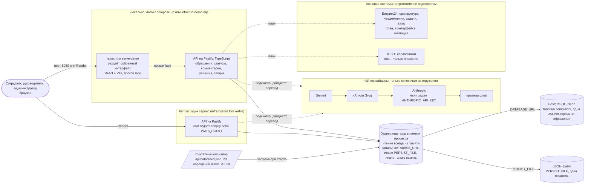

# Архитектура решения

> Задача #108, сверено с main на 13.11.2026: `docker-compose.yml`, `infra/nginx.conf`, `infra/web.Dockerfile`, `infra/api.Dockerfile`, `infra/hosted.Dockerfile`, `infra/render.yaml`, `api/src` (`app.ts`, `server.ts`, `store.ts`, `persistence.ts`, `pg-persistence.ts`, `complaints.ts`, `lifecycle.ts`, `analytics.ts`, `ai/provider.ts`, `ai/openai-compatible.ts`, `ai/anthropic.ts`, `seed.ts`). Полное описание — в [docs/architecture.md](../../docs/architecture.md).

**Подпись:** Архитектура прототипа: веб-интерфейс, API и хранилище с тремя режимами (память, файл, PostgreSQL); ИИ-провайдеры вызываются по ключам; 1С и Битрикс24 показаны как план.

**Что сказать на слайде:** Прототип работает в трёх режимах хранения: без базы данных (память процесса, по желанию с JSON-файлом), а на хостинге, в Render, с PostgreSQL в Neon; подсказка категории, дайджест и перевод идут по ИИ-цепочке Gemini, затем xAI или Groq, затем Anthropic, а без ключей работают по записанным примерам и правилам слов. Интеграции с 1С и Битрикс24 мы честно показываем как план: подключений в прототипе нет, обмен только описан.

## Что есть что

| Блок на схеме | Где в репозитории | Состояние |
|---|---|---|
| Интерфейс (React, Vite) за nginx или на Render | `web/`, `infra/web.Dockerfile`, `infra/nginx.conf`, `infra/hosted.Dockerfile` | реализовано |
| API (Fastify) | `api/src/app.ts`, `server.ts`, `complaints.ts`, `lifecycle.ts`, `analytics.ts` | реализовано |
| Хранилище в памяти | `api/src/store.ts`: чтение из памяти, без ключей и файла данные сбрасываются к seed при перезапуске | реализовано |
| Файл (`PERSIST_FILE`) | `api/src/persistence.ts`: JSON-снимок с атомарной записью | реализовано |
| PostgreSQL (`DATABASE_URL`) | `api/src/pg-persistence.ts`, Neon на Render; приоритет над файлом | реализовано, миграций схемы нет |
| Синтетические данные | `api/data/seed.json`, `api/src/seed.ts`; `SEED_RELATIVE_DATES=1` сдвигает даты | реализовано |
| ИИ-провайдеры | `api/src/ai/provider.ts`, `ai/openai-compatible.ts` (Gemini, xAI, Groq), `ai/anthropic.ts`, `ai/translate.ts`, `ai/rules.ts` | реализовано, по ключам |
| Вход | выбор демо-пользователя, заголовок `X-Demo-User` | имитация |
| Битрикс24, 1С УТ | [описание интеграций](../../docs/research/integrations.md) | план |
