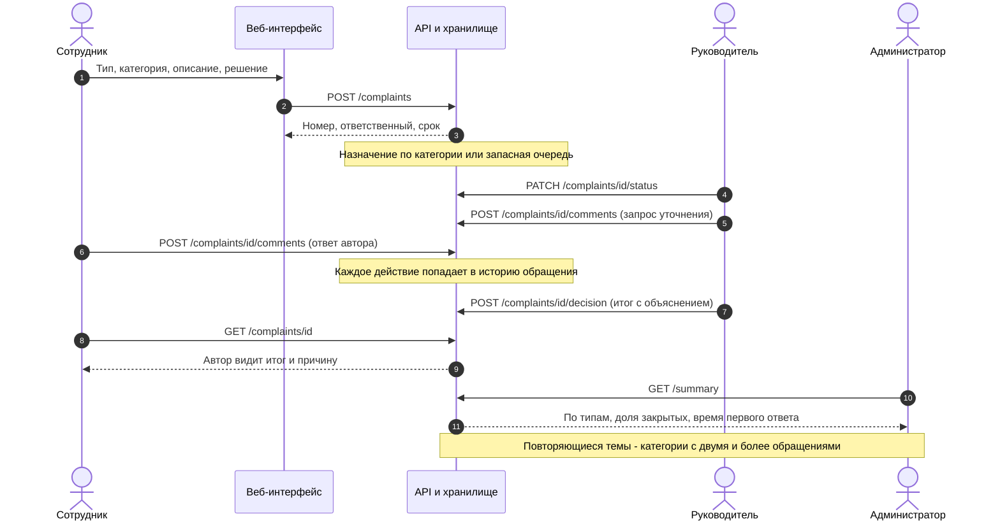

# Поток данных: от подачи до итога и сводки

> Задача #108. Сверено с путями `contracts/api.yaml` и обработчиками в `api/src/complaints.ts`, `api/src/lifecycle.ts`, `api/src/analytics.ts`.

**Подпись:** Путь обращения: подача, назначение, уточнение, решение, итог для автора и повторяющиеся темы в сводке.

**Что сказать на слайде:** Одно обращение проходит весь путь внутри системы: от формы сотрудника через назначение и уточнение до решения, которое автор видит вместе с объяснением. Из этих же записей собирается сводка для администратора, где видны повторяющиеся темы, а не отдельные жалобы.

## Какие данные где появляются

| Шаг | Что записывается | Кто видит |
|---|---|---|
| Подача (`POST /complaints`) | тип, категория, описание, предлагаемое решение, метаданные вложения-заглушки, автор из сессии | автор, руководители, администратор |
| Назначение | ответственный, очередь и причина (`category_rule`, `no_rule`, `manual_assignment`), срок | автор, руководители, администратор |
| Статусы и комментарии | событие в истории с датой и участником | автор, руководители, администратор |
| Решение (`decision`) | итог и обязательное объяснение | автор, руководители, администратор |
| Сводка (`GET /summary`) | количество по типам, доля закрытых, среднее время первого ответа, повторяющиеся темы | администратор |

Сотрудник видит только свои обращения. Данные синтетические и хранятся в памяти, даты в seed условные.
