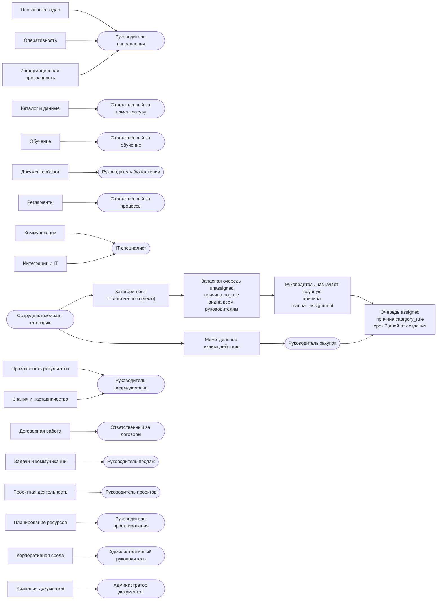

# Маршрутизация обращения

> Задача #108. Сверено с `api/src/seed.ts` (справочник категорий строится из `api/data/seed.json`) и `api/src/complaints.ts` (назначение при создании и вручную). Подробные правила: [docs/research/routing.md](../../docs/research/routing.md).

**Подпись:** Маршрутизация: категория определяет ответственного, а обращение без правила попадает в запасную очередь руководителей.

**Что сказать на слайде:** Сотрудник выбирает категорию, и система сама назначает ответственного и срок, без ручного разбора входящих. Если для категории правила нет, обращение не теряется: оно попадает в запасную очередь, откуда любой руководитель назначает исполнителя вручную.

## Пояснения

- На схеме стрелка в очередь `assigned` проведена от одного ответственного, чтобы не загромождать слайд; так же обрабатываются все 18 категорий с правилом.
- От узла «Сотрудник выбирает категорию» показаны два примера: категория с правилом и демо-категория без правила.
- 18 категорий и 14 ответственных ролей взяты из датасета; роли условные.
- У «Корпоративной среды» в датасете два ответственных (A-017 и A-018); справочник берёт первого, административного руководителя.
- Срок единый, 7 дней для всех категорий (`dueInDays: 7`); зависимость срока от приоритета описана как план.
- Правка правил администратором в прототипе не реализована, справочник только для чтения.
