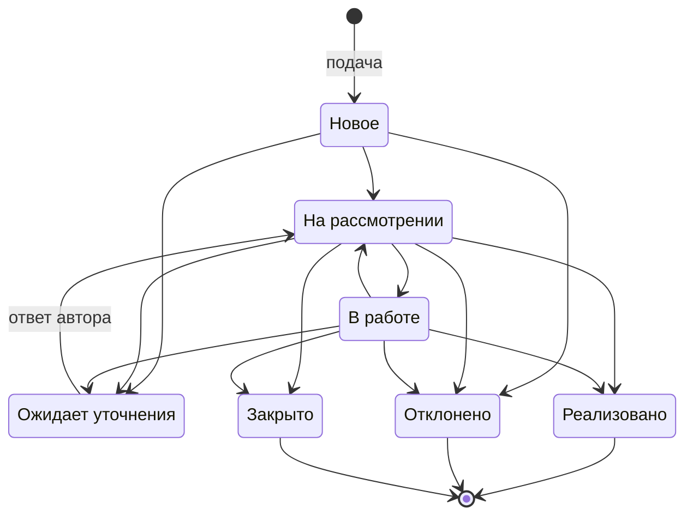

# Жизненный цикл обращения

> Задача #108. Переходы взяты из `x-status-transitions` в `contracts/api.yaml`; приёмочный тест `tests/acceptance/108-diagrams.test.mjs` разбирает эту схему и сравнивает её с контрактом.

**Подпись:** Статусы обращения и разрешённые переходы между ними по контракту API.

**Что сказать на слайде:** У обращения семь статусов, и три из них конечные: реализовано, отклонено и закрыто. Из уточнения обращение всегда возвращается на рассмотрение, а закрыть его можно только с записанным итогом, поэтому автор не остаётся без ответа.

## Пояснения

- Конечные статусы (`implemented`, `rejected`, `closed`) переходов не имеют.
- Из статуса «Новое» нельзя сразу перейти в «Реализовано» или «Закрыто»: сначала рассмотрение.
- «Ожидает уточнения» ведёт только в «На рассмотрении»: после ответа автора обращение возвращается руководителю.
- Итог (реализовано, отклонено, закрыто) записывается решением с объяснением (`POST /complaints/{complaintId}/decision`).
