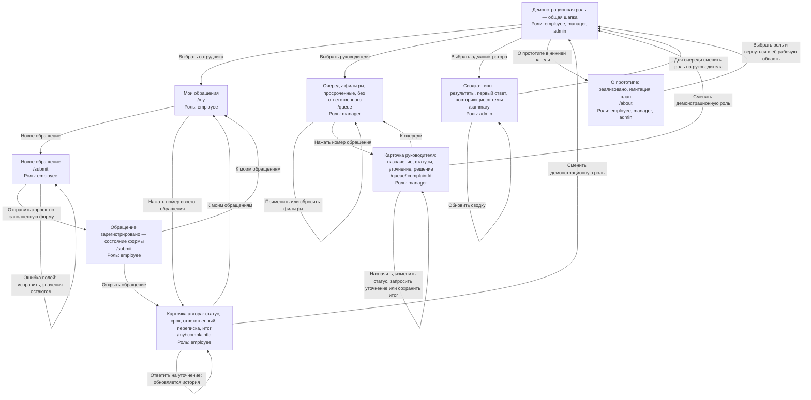

# Карта экранов и переходов

Задача #8, требования R10 и R5. Основа — [шесть шагов демо](../../docs/tz-analysis.md), [персоны и сценарии](../personas/personas.md), [границы MVP](../../docs/manifest.md). Карта описывает существующие маршруты [App.tsx](../../web/src/App.tsx) на момент подготовки; дальнейшие макеты могут менять композицию, сохраняя этот путь и роли.

## Основной путь

Прямоугольники — экраны или явно подписанные состояния экрана. «Демонстрационная роль» — общий переключатель в шапке, а не отдельная страница и не авторизация: это **имитация входа**. Подписи стрелок показывают действия человека; переход между автором и руководителем выполняет ведущий демонстрации. Из любой страницы переключатель доступен в шапке, а ссылка «О прототипе» — внизу.

Карточки `author` и `handling` используют один компонент, но имеют разные маршруты и доступные действия. Статусы, переписка и решение — состояния внутри карточки, не дополнительные страницы. Подтверждение `registered` остаётся на `/submit` и показывает присвоенный номер A-0XX и следующий шаг. Источники: [форма](../../web/src/pages/SubmitPage.tsx), [карточка](../../web/src/pages/ComplaintPage.tsx), [действия в карточке](../../web/src/features/ComplaintActions.tsx).

## Шесть шагов для ведущего демо

В колонке «Экраны» указаны идентификаторы узлов диаграммы. При смене роли нужно найти то же обращение по присвоенному номеру; карта не подразумевает автоматического перехода к той же карточке от имени другого человека.

| Шаг | Экраны | Действие пользователя | Наблюдаемый результат |
|---|---|---|---|
| 1 | `submit`, `registered`, `author` | Сотрудник закупок выбирает «Проблема», категорию «Межотдельное взаимодействие», вводит описание и предлагаемое решение, включает тестовое вложение и отправляет | Подтверждение регистрации с номером A-0XX; по «Открыть обращение» доступны сведения о подаче и следующем действии |
| 2 | `author`, `queue`, `handling` | В карточке показать автоматическое назначение и срок; отдельно создать обращение с категорией «Категория без ответственного (демо)», сменить роль на руководителя и выбрать очередь «Без ответственного» | В первом случае указан ответственный; во втором обращение остаётся в запасной очереди, в карточке руководитель может назначить его вручную |
| 3 | `handling`, `author` | Руководитель переводит обращение на рассмотрение и запрашивает уточнение; ведущий выбирает сотрудника, открывает его обращение и отвечает в карточке | Запрос, ответ автора и изменения статусов видны в комментариях и истории; следующий шаг подсказывает дальнейшее действие |
| 4 | `handling`, `author` | Руководитель закрывает одно обращение решением, другое мотивированным отказом; сотрудник открывает каждое из своих обращений | Автор видит итог и объяснение отказа или решения; нельзя сохранить итог без пояснения, история остаётся в карточке |
| 5 | `queue`, `handling` | Руководитель применяет фильтры подразделения, категории, статуса, периода срока и «Только просроченные», затем открывает найденное обращение | Список показывает подходящие обращения и просрочку; в карточке доступны срок и история; «Сбросить» возвращает всю очередь |
| 6 | `summary` | Ведущий выбирает администратора и открывает сводку, при необходимости нажимает «Обновить сводку» после действий | Видны обращения по типам, доля закрытых, среднее время первого ответа и повторяющиеся темы по категориям |

Шаги 1–4 соответствуют сценариям С1–С3 и Р1–Р3 из [персон](../personas/personas.md); шаги 5–6 — Р3 и А1. Фильтры и метрики сверены с [очередью](../../web/src/pages/QueuePage.tsx) и [сводкой](../../web/src/pages/SummaryPage.tsx).

## Кто видит экран

| Экран / состояние | Роль | Граница доступа и действия |
|---|---|---|
| `mine`, `submit`, `registered` | `employee` — сотрудник | Подаёт обращения и видит только свои; успешная отправка открывает подтверждение |
| `author` | `employee` — автор этого обращения | Читает статус, срок, ответственного, историю и итог; отвечает на запрос уточнения; чужая карточка через API недоступна |
| `queue`, `handling` | `manager` — руководитель | Просматривает очередь, в том числе без ответственного, фильтрует, назначает, ведёт статусы, запрашивает уточнение и записывает решение |
| `summary` | `admin` — администратор | Просматривает общие показатели; в текущей веб-навигации очередь администратору недоступна |
| `roles`, `about` | `employee`, `manager`, `admin` | Переключение демонстрационной роли и сведения о границах прототипа доступны всем |

Роль — обязательная часть пути. **Администратор: очередь и карточка руководителя недоступны в текущем интерфейсе.** API может давать более широкое чтение; карта не расширяет права экранов. Ссылка «Открыть в очереди» из сводки ведёт на защищённый маршрут: сначала возвращает администратора в сводку; после выбора руководителя открывается запомненный адрес с фильтром категории. Этот дополнительный переход не входит в обязательный шаг 6. См. [RoleRoute и returnPath](../../web/src/App.tsx) и [контракт ролей](../../contracts/api.yaml).

## Дополнительные маршруты

| Маршрут | Роль | Доступ и действия |
|---|---|---|
| `/admin` | `admin` | Из меню «Пользователи и права» администратор управляет демонстрационными пользователями, ролями и настройками назначения по категориям. |

## Возврат, ошибки и честные ограничения

- `/` перенаправляет сотрудника на `/my`, руководителя на `/queue`, администратора на `/summary`. Попытка открыть маршрут другой роли возвращает в доступную рабочую область. Неизвестный адрес показывает «Страница не найдена» и ссылку возврата; этот служебный экран доступен всем трём ролям. [Маршрутизация](../../web/src/App.tsx).
- При загрузке экран показывает состояние ожидания; ошибка загрузки имеет повторную попытку. В очереди без результатов есть подсказка изменить или сбросить фильтры; пустая сводка не выдаёт отсутствующие данные за нулевое время ответа. [Очередь](../../web/src/pages/QueuePage.tsx), [сводка](../../web/src/pages/SummaryPage.tsx).
- Ошибки ввода остаются в форме, фокус переходит к первому неверному полю. Пока отправка выполняется, повторная отправка заблокирована; при ограничении частоты показывается ожидание. [Форма](../../web/src/pages/SubmitPage.tsx).
- Тестовое вложение — имитация: сохраняются только название, тип и размер заглушки; содержимое не загружается. Выбор роли не заменяет настоящий вход. Полная анонимность, реальные уведомления и корпоративные интеграции не добавляются этой картой; будущие экраны требуют отдельного согласования. [Форма](../../web/src/pages/SubmitPage.tsx), [границы демо](../../docs/tz-analysis.md).
