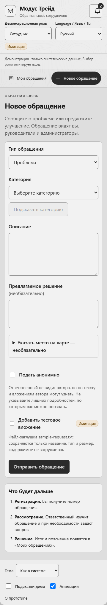
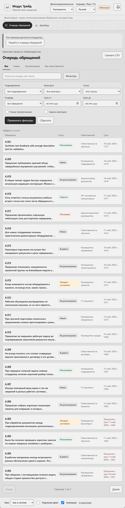
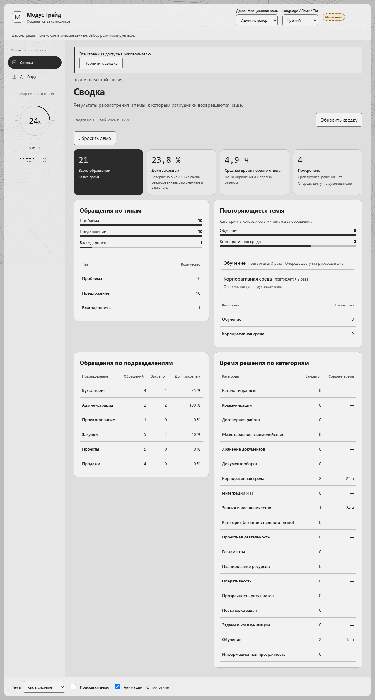

# Финальный UX-аудит, 12 ноября 2026

Задача: [#302](https://github.com/GredesCerber/employee-feedback/issues/302).
Проверенный исходный коммит: `f7f2eb164713e4b3fcbe59a34c4baa7af5986d68`.
Стенд: `http://127.0.0.1:5182`, API: `http://127.0.0.1:3102`.
Он собран из worktree задачи командой
`node infra/run-demo.mjs --api-port 3102 --web-port 5182`.
Это локальное демо с синтетическими данными, не публичный адрес.

**Итог: INCONCLUSIVE для полной визуальной и доступностной приёмки.** Основной
пользовательский путь пройден, выявлены воспроизводимые проблемы P2/P3.
Визуального baseline нет, часть контраста требует ручной проверки, полный
клавиатурный путь и Safari не проверены. Это не заключение о полной доступности
или отсутствии остальных дефектов. Для демонстрации основного пути есть
положительные наблюдения ниже; найденные проблемы следует исправлять отдельными
задачами зоны `web`.

Исполнитель использовал трёх помощников Terra: браузерный проход ECC, статическое
прослеживание обработчиков и отдельный автоматический axe/layout-проход,
а также подготовку продуктовых вопросов капитану. Это внутренние проверки
исполнителя, не независимое ревью для `hk-guard`. Исследования с сотрудниками
компании не проводились. Продуктовый код и стили не изменялись.

## Метод и доказательства

- ECC `browser-qa`: ручной проход реального локального интерфейса через Chrome
  DevTools, наблюдение сети, консоли и фокуса.
- ECC `click-path-audit`: прослеживание вызовов и изменений состояния в коде.
  Выводы статического анализа ниже отделены от runtime-подтверждений.
- Отдельный Chromium Playwright с axe-core 4.14.0: 56 проверок
  (8 экранов × 7 сочетаний языка, темы и ширины), без ошибок выполнения.
  Теги: WCAG 2 A/AA, 2.1 A/AA, 2.2 AA. Это автоматическое покрытие части правил.
- [Машинный результат axe/layout](evidence/automated.json) содержит SHA,
  конфигурации, конечные URL, заголовки, нарушения, `incomplete` и размеры.
- [Скриншоты](evidence/automated/) сняты Playwright. Сохранение файлов через ECC
  DevTools в worktree было отклонено ограничением доступа инструмента;
  это ограничение сбора артефактов, не дефект продукта.

Повторить автоматическую выборку можно на отдельном синтетическом стенде:

```powershell
npm ci --prefix tests/e2e
npm --prefix tests/e2e run e2e:install
npm install --prefix .hk/qa-tools --no-save --package-lock=false axe-core@4.14.0
# В отдельном терминале: node infra/run-demo.mjs --api-port 3102 --web-port 5182
node design/qa/final-2026-11-12/audit.mjs
```

Скрипт принимает `QA_BASE_URL` и пишет `evidence/automated-latest.json`, не
перезаписывая исходный результат этого отчёта. Для сопоставления нужен тот же
исходный код и данные. Скрипт не создаёт и не сбрасывает обращения, но переключает
демо-роли в своём браузерном контексте; применять его следует только к демо-стенду.

## Наблюдённые пользовательские пути

| Роль и путь | Действия и ожидаемый итог | Фактически |
|---|---|---|
| Сотрудник, `/submit` | Отправить некорректную форму, увидеть ошибку и фокус поля | Ошибка и фокус категории есть; язык ошибки не соответствует English, UX-01 |
| Сотрудник, `/submit` | Training + описание, отправить, получить номер и следующий шаг | Создано синтетическое A-021, показаны ответственный, срок и Next step |
| Сотрудник, `/my/:id` | Открыть зарегистрированное обращение | Карточка A-021 открывается |
| Руководитель, `/queue/:id` | Start Review, записать решение с обоснованием | Статус изменён, итог Implemented сохранён |
| Сотрудник, `/my/:id` | После обработки увидеть результат | У A-021 видны Implemented и текст итога |
| Руководитель, `/queue` | Совместить поиск и выбор фильтра | Поиск работает, но стирает неприменённую категорию, UX-03 |
| Руководитель, `/queue` | Страница 2, карточка, To the queue | Возврат на страницу 1 вместо 2, UX-04 |
| Руководитель, `/dashboard` | Открыть общую картину и weekly summary | На проверенном наборе 21 всего, 16 открыто, 4 просрочено; показан Template (no AI) |
| Администратор, `/summary` | Открыть метрики и итог обработки | 21 всего, 5 закрыто, 23.8%; EN содержит русские подписи, UX-01 |
| Любая демо-роль | Понять границы имитации | Шапка сообщает об имитации входа; форма явно описывает тестовое вложение |

Числа относятся к состоянию после создания A-021. Начальный seed и повторный
запуск могут дать другие числа. Обращение создавалось исключительно в памяти
этого локального стенда. Мотивированный отказ, уточнение и ответ автора в этом
ручном проходе не повторялись: их предыдущие E2E-прогоны не подменяют наблюдения
этого аудита; регрессия отдельно поручена #301.

## Автоматическая матрица

Каждая строка покрывает `/submit`, `/my`, карточку сотрудника, `/queue`, карточку
руководителя, `/summary`, `/dashboard` и `/about` при подходящей роли.

| Ширина, px | Язык | Тема | Выполнено |
|---|---|---|---|
| 360 | ru | light | 8/8 |
| 768 | ru | light | 8/8 |
| 1280 | ru | light | 8/8 |
| 360 | en | dark | 8/8 |
| 1280 | en | light | 8/8 |
| 360 | kk | light | 8/8 |
| 1280 | kk | dark | 8/8 |

Это выборка, не полное произведение всех настроек. Во всех 56 случаях ширина
документа не превысила viewport. Внутренний скролл таблицы `/about` не считается
горизонтальным переполнением всей страницы. Скрипт выявил выходящие за viewport
элементы внутри этой таблицы; связанные ограничения клавиатуры приведены в UX-05.
Axe оставил `color-contrast` в состоянии `incomplete` в 27 случаях. Ни контраст,
ни доступность в целом не объявляются пройденными.





## Подтверждённые проблемы и следующие задачи

### UX-01, P2: смешение языков в валидации и итогах

Зона: `web`. Воспроизведение: English → New request → заполнить описание →
Send без категории. Ожидается ошибка на выбранном языке. Фактически поле
сфокусировано и помечено invalid, но текст: "Выберите категорию.".
[Снимок](evidence/automated/validation-en.png) также показывает английскую
ошибку описания рядом с русской ошибкой категории.

В English на сводке под Average first response time остаются
"По 16 обращениям с первым ответом" и "4.9 ч". После действий руководителя
наблюдались русские live announcements "Статус обращения изменён." и
"Итог рассмотрения зафиксирован.".

Источники: `web/src/pages/SubmitPage.tsx:71,117`,
`web/src/pages/SummaryPage.tsx:149`, `web/src/features/ComplaintActions.tsx`.
Влияние: иностранному читателю и пользователю screen reader труднее понять
ошибку и подтверждение. Предлагаемая отдельная задача: привести валидацию,
единицы времени, helper-тексты и объявления к выбранному языку; регрессия ru/en/kk.
Русский вывод для kk предсказан статическим анализом, но в ручном проходе
ошибка для kk отдельно не подтверждалась.

### UX-02, P2: несохранённая форма исчезает при смене демо-роли

Зона: `web`. Воспроизведение: Employee → `/submit` → ввести описание →
выбрать Manager → выбрать Employee → `/submit`.
Ожидается сохранение черновика либо предупреждение перед потерей.
Фактически переход происходит без предупреждения, оба textarea пусты.

Источник: `web/src/App.tsx:99-107,126`, локальное состояние SubmitPage.
Влияние: потеря введённого текста во время демонстрации или исследования ролей.
Это поведение демо-переключателя, не утверждение о настоящем входе, которого нет.
Предлагаемая задача: согласовать и реализовать предупреждение или черновик
с явной изоляцией по роли; тест переключения с заполненной формой.

### UX-03, P2: поиск сбрасывает ещё не применённую категорию

Зона: `web`. Воспроизведение: Manager → `/queue` → выбрать Category Training,
не нажимать Apply filters → ввести A-021 в Search → подождать 600 мс.
Ожидается, что выбор в форме не исчезнет молча. Фактически URL становится
`/queue?q=A-021`, Category возвращается к All categories.

Источник: `web/src/pages/QueuePage.tsx:101-120`: поиск меняет URL,
пересоздаётся `applied`, эффект `setFilters(applied)` стирает черновик формы.
Влияние: лишние действия и ощущение ненадёжного фильтра.
Предлагаемая задача: определить единый момент применения поиска/фильтров
или сохранять черновые фильтры при изменении только q; тест последовательности.

### UX-04, P3: возврат из карточки теряет страницу списка

Зона: `web`. Нужен набор минимум 21 запись, в аудите это seed + A-021.
Воспроизведение: очередь → Next, Page 2 of 2 → A-001 → To the queue.
Ожидается возвращение на Page 2. Фактически открывается Page 1 of 2.

Источники: `web/src/pages/QueuePage.tsx:105,237`,
`web/src/pages/ComplaintPage.tsx:58-61`: передаётся search, но не offset.
Влияние: потеря места в длинном списке после просмотра карточки.
Предлагаемая задача: сохранять пагинацию в URL или navigation state и
восстанавливать её вместе с фильтрами; тест возвращения со второй страницы.

### UX-05, P2: автоматическое нарушение доступности прокручиваемой таблицы

Зона: `web`. Воспроизведение автоматикой: `/about`, 360 px, сочетания ru/light,
en/dark, kk/light. Axe: `scrollable-region-focusable`, impact `serious`,
селектор `.about-table-wrap`. Контейнер со скроллом не имеет явного
клавиатурного фокуса и фокусируемого содержимого.

Ожидается доступ к скрытым колонкам с клавиатуры. Требование axe касается
в том числе Safari; фактическое поведение Safari здесь не проверено.
Это подтверждённое срабатывание правила, не подтверждённый отказ всех браузеров.
Влияние: риск недоступности части таблицы для клавиатурного пользователя.
Предлагаемая задача: ручная проверка Chrome/Safari и корректное фокусируемое,
подписанное скроллируемое представление без потери семантики таблицы.
Доказательство: violations и selectors в [JSON](evidence/automated.json).

## Статическая карта путей

- Подача: `SubmitPage.tsx:67-107,114-141` → POST → номер, срок, ответственный,
  следующий шаг. `lock` и disabled ограничивают повторную отправку;
  отдельный runtime-тест гонки двойного клика в этом аудите не выполнялся.
- Автор: `MyComplaintsPage.tsx:25-43` → `ComplaintPage.tsx:25-34,58-69` →
  `AuthorReply`, `ComplaintActions.tsx:47-60`.
- Руководитель: `QueuePage.tsx:99-120,152-246` → карточка с queueSearch →
  `ManagerActions`, `ComplaintActions.tsx:64-115`; мутации защищены lock.
- Сводка/дашборд: `SummaryPage.tsx:135-163`, `DashboardPage.tsx:75-141`.
- Последнее обращение: `ResumeComplaint.tsx:20-55` проверяет доступ и ошибки;
  карточка на 403/404 забывает указатель. Runtime-отказ доступа не воспроизводился.
- Уведомления: `notifications.tsx:25-119` содержит открытие, прочтение,
  переход, повтор при ошибке и опрос; полный цикл не воспроизводился вручную.

## Сеть, доступность и границы заключения

- В наблюдённой ECC-сессии: 0 console error/warn; все 81 показанный запрос
  завершились 200 или 201. Это не проверка всех запросов и сценариев продукта.
- Частичный keyboard: на Summary Tab последовательно переводил фокус на
  Update Summary и Reset demo; вычисленный outline `solid 3px`.
  Полный путь подачи/обработки только клавиатурой не пройден.
- Автопроход выполнялся с `prefers-reduced-motion: reduce`; это проверка
  возможности отрисовки в таком окружении, не полная проверка поведения анимаций.
- Визуальное сравнение с эталоном: **INCONCLUSIVE**, согласованного baseline нет.
  Приложенные снимки являются текущими доказательствами, не эталоном регрессии.
- Контраст: непроверенные axe-узлы требуют ручного измерения; вывод "AA пройден"
  не делается. Скринридер, Safari, Firefox, CWV и нагрузка не проверялись.
- Пустые состояния, недоступный API, восстановление после сетевой ошибки,
  отказ и уточнения требуют отдельной проверки #301. Статическое наличие
  обработчиков не засчитывается как runtime PASS.

Корпоративные интеграции необязательны, Битрикс24 у компании облачный.
Живые интеграции не проверялись и не представляются реализованными.
Реальный вход и загрузка файлов остаются отдельными продуктовыми вопросами
#287/#288/#290. Ответов за капитана этот аудит не принимает.

## Проверка сдачи отчёта

Файлы этой задачи находятся только в `design/qa/final-2026-11-12/`.
Автоматическая матрица и изображения не содержат реальных данных компании.
Полный `hk check` перед сдачей фиксируется исполнителем в PR; положительный
результат проверок кода не отменяет перечисленных UX-проблем и ограничений аудита.
